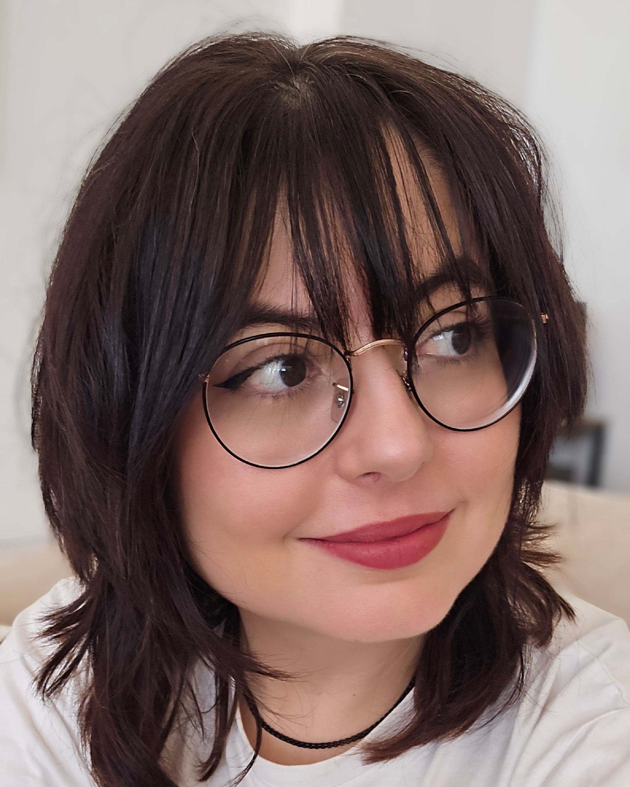

{: width="200px"}
# Rocío 'Rothio' Tomé (She/Her)
### Game Developer - Programmer

---

## About me
Rocío "Rothio" Tomé is the Creative Technical Director and co-founder of Patattie Games, the studio that debuted with the award-winning Wax Heads. A programmer holding a Master’s degree in Psychology with a decade of engineering experience — ranging from experimental game jams to B2B VR applications for medical training — she is a recognised authority on game engines like Godot, where she also serves as a Board Member of the Godot Foundation. A seasoned international speaker and online personality, Rocío frequently shares her expertise on major stages such as A MAZE, GodotCon, and Mobile World Congress.

Rocío's frequent contributions to the Spanish and international games industry include the creation of thousands of hours of educational developer-targeted content creation on Twitch and YouTube, co-founding FemDevs, and creating various free open-source tools for developers. She was recognised for these and other efforts by winning the prestigious GameDevHeroes award in 2026.

Blending technical ability with an academic background in behavioural sciences, she serves as a highly versatile consultant and media speaker on the realities of indie development, engine architecture, accessibility, and the psychological impacts of game production.

---

## Bio
Rocío 'Rothio' Tomé is a Spanish game developer. She is best known as the Creative Technical Director at Patattie Games, the studio she co-founded to create Wax Heads, and as a Board Member of the Godot Foundation. She is also recognized for her frequent talks at technology events and her public outreach through Twitch, YouTube, and social media.

---

## Short Bio
Rocío 'Rothio' Tomé is a Spanish game developer, programmer, and Creative Technical Director at Patattie Games (the studio behind the award-winning Wax Heads), as well as a Board Member of the Godot Foundation.

---

## Media Assets
- 📁 [Personal Media Assets](https://drive.google.com/drive/folders/1NK5Vyn4sveohfPq4g_KlrrjlCtCm_zs0)
- 💿 [Wax Heads Media Assets](https://drive.google.com/drive/folders/1s2y3t8tW1h0Jvke0HlOj2u3Q7_MQJ5MS)

---

## Topics for interviews and citations
- Current state of the video game development industry
- The reality of independent game development
- Implementing accessibility in video games
- Game engines, especially Godot
- Participating in game jams and developing experimental games
- Psychological impact of solo development or small teams

---

## Awards
* **Individual**
	* **Winner** – Best Programmer @ GameDevHeroes (2026)
* **Wax Heads**
	* **Winner** – Best Music and Sound Design (Composer: Gina Loughlin) @ Indie Dev Day (2024)
	* Finalist – Best Game @ IndieDevDay (2024)
	* Finalist – Best Art @ IndieDevDay (2024)
	* Finalist – Best Narrative @ IndieDevDay (2024)
	* Finalist - Choice @ DevGAMM Awards (2026) 
	* Finalist – Game of the Year (GOTY) @ BIG Conference Titanium Awards (2026)
	* Finalist – Best Narrative Design @ BIG Conference Titanium Awards (2026)
	* Finalist – Best Sound Direction @ BIG Conference Titanium Awards (2026)
* **Diggy Doggo Daylight Dungeon**
	* **Winner** – Best SoloDev Game @ Indie Spain Jam (2023)
	* **Winner** – Best Jam Game @ Devuego Awards (2023)
* **mk creature.zip**
	* **Winner** – Public award @ Indie Developer Burger Awards (2020)
* **Cube Knob Button**
	* **Winner** – Replay Value @ Indie Spain Jam (2022)
	* **Winner** – Most Addictive Game @ Indie Dev Day (2022)

---

## Links
* Bluesky: [https://bsky.app/profile/rothiotome.bsky.social](https://bsky.app/profile/rothiotome.bsky.social)
* Linkedin: [https://www.linkedin.com/in/rtomegonzalez](https://www.linkedin.com/in/rtomegonzalez)
* Instagram: [https://www.instagram.com/rothiotome/](https://www.instagram.com/rothiotome/)
* Twitch: [https://www.twitch.tv/rothiotome](https://www.twitch.tv/rothiotome)
* Itch.io: [https://rothiotome.itch.io/](https://rothiotome.itch.io/)
* youtube: [https://www.youtube.com/@RothioTome](https://www.youtube.com/@RothioTome)
* email: rothiotome (at) gmail (dot) com
